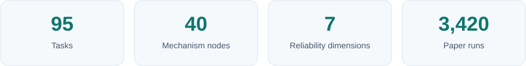

<div align="center">


**When an AI agent fails, was it the model — or the harness around it?**

Code and tasks for *Trial by Trace: Benchmarking AI Agent Harnesses for Reliability and Failure Attribution*

[](https://arxiv.org/abs/2610.32285)
[](https://tracelite.ai/trial-by-trace.html)
[](https://tracelite.ai/leaderboard.html)
[](https://huggingface.co/spaces/TraceLite-AI/Trial-by-Trace)
[](LICENSE)

**English** · [简体中文](README_zh.md)

</div>

<p align="center">
  <a href="#overview">Overview</a> ·
  <a href="#results">Results</a> ·
  <a href="#quick-start">Quick start</a> ·
  <a href="#benchmark">Benchmark</a> ·
  <a href="#citation">Citation</a>
</p>

<p align="center">
  
</p>

## Overview

A coding/ops agent is **a model plus a harness**. The harness runs tools, manages context, asks for approval, spawns sub-agents and decides when the job is done. Claude Code, Codex, OpenClaw and DeepSeek Harness are the four harnesses evaluated in the paper.

Task success alone hides the source of a failure. A model can finish despite a silently dropped error; it can also fail when the harness behaves correctly. TraceTrial-Bench examines the **execution trace** and scores these two layers separately.

<p align="center">
  <a href="docs/assets/tracetrial-benchmark-main-v2.webp">
    
  </a>
</p>

<p align="center"><sub>Framework overview: mechanism-focused tasks, multi-source evidence and run-level attribution. Click to view at full size. · <a href="https://tracelite.ai/trial-by-trace.html">Technical report</a></sub></p>

| Stage | What TraceTrial-Bench does |
| :--- | :--- |
| **Run** | Executes 95 mechanism-focused tasks across 4 harnesses × 9 models, giving 36 combinations and 3,420 Docker runs. |
| **Inspect** | Normalizes traces and extracts evidence about tool calls, context, execution and task outcomes. |
| **Score** | Evaluates **Harness** behavior and **Agent** task performance independently. |
| **Attribute** | Identifies harness-caused failures, agent-caused failures and harness defects that the agent worked around. |

## Results

> **31.1%** of runs succeed at the task despite failing at least one harness criterion. Only **8.4%** pass every criterion in both layers.

Claude Code has the highest Agent Pass rate; OpenClaw has the highest Harness Macro score. Harness Macro spans **12.2 percentage points**, from 59.8% to 72.0%.

<p align="center">
  <a href="docs/assets/overall-score-model-harness.webp">
    
  </a>
</p>

<p align="center"><sub>Overall performance: model scores average over four harnesses; harness scores average over nine models. · <a href="https://tracelite.ai/trial-by-trace.html">Technical report</a></sub></p>

| Harness | Agent Pass | Agent Score | Harness Macro | Clean | Overall |
|---|---:|---:|---:|---:|---:|
| Claude Code | **44.0** | **75.9** | 71.2 | 9.1 | **73.5** |
| Codex | 35.8 | 70.7 | 59.8 | 2.8 | 65.2 |
| DeepSeek Harness | 40.0 | 73.3 | 68.8 | 9.8 | 71.0 |
| OpenClaw | 38.2 | 71.7 | **72.0** | **11.7** | 71.8 |

<sub>All values are percentages, averaged over 9 models × 95 tasks (855 cells per harness). Bold marks the best value in each column.</sub>

<details>
<summary><strong>How to read the metrics</strong></summary>

- **Agent Pass:** every Agent criterion passes.
- **Clean:** every criterion in both layers passes.
- **Overall:** mean of Agent Score and Harness Macro.

Per-model results and case studies are available in the [technical report](https://tracelite.ai/trial-by-trace.html) and on the [leaderboard](https://tracelite.ai/leaderboard.html).

</details>

## Quick start

**Prerequisites:** Python ≥ 3.11 and Docker. Commands below use a Linux shell; on Windows, use WSL.

### 1. Install and configure

```bash
git clone https://github.com/TraceLite-AI/TraceTrial-Bench.git
cd TraceTrial-Bench
python3 -m venv .venv
.venv/bin/pip install -e .
cp configs/models.example.toml model.toml
chmod 600 model.toml
```

Edit `model.toml` with your provider endpoint, model identifier and API key. The commands below use its `deepseek` alias. Keep this credential file private.

### 2. Build a harness and run one task

```bash
.venv/bin/tracetrial_bench image build --harness openclaw \
  --model-registry ./model.toml --output-dir outputs/image-builds

.venv/bin/tracetrial_bench run --smoke --harness openclaw --model deepseek \
  --mode docker --model-registry ./model.toml --output-dir outputs/runs
```

### 3. Run the paper benchmark

```bash
.venv/bin/tracetrial_bench run --task-manifest tasks/lean95.manifest \
  --harness openclaw --model deepseek --judge-model deepseek \
  --mode docker --concurrency 4 --model-registry ./model.toml --output-dir outputs/runs
```

### 4. Inspect the report

```bash
.venv/bin/tracetrial_bench report outputs/runs/<run-directory>
```

| Output | Contents |
| :--- | :--- |
| `result.json` | Status, scores, tokens, cost and timing |
| Normalized trace | Model and harness execution evidence |
| `artifacts/verifier_output/score.json` | Rule-check results |
| `artifacts/llm_judge/combined_score.json` | Harness and Agent layer scores |

## Benchmark

Each task targets one of **7 reliability dimensions**. Prompts provide a goal, materials and a deliverable without revealing the mechanism being tested.

| Code | Dimension | What it covers | Tasks | Nodes |
| :---: | :--- | :--- | ---: | ---: |
| **C** | Context | Information preservation, isolation and recovery | 15 | 6 |
| **E** | Execution | Process semantics and faithful result delivery | 27 | 9 |
| **G** | Governance | Permissions, policies and security boundaries | 9 | 4 |
| **L** | Lifecycle | Session transitions, delegation and state recovery | 19 | 8 |
| **O** | Observability | Faithful diagnostic and failure channels | 7 | 2 |
| **T** | Tools | Tool interfaces, discovery and transport fidelity | 17 | 10 |
| **V** | Verification | Completion claims versus authoritative outcomes | 1 | 1 |
| | **Total** | | **95** | **40** |

**Start with the [95-task manifest](tasks/lean95.manifest).** The [task-set guide](tasks/lean95.README.md) explains the selection; the [naming map](docs/task-naming.md) lists every old/new ID and node mapping.

Task IDs follow `<node>-<description>-<NNN>`, for example `C1-escalation-export-001`. A leading `L3-` denotes Lifecycle node 3; difficulty metadata is unchanged. The historical `lean96.manifest` retains the additional hostrecord task excluded from the paper results.

## Repository guide

| Path | Purpose |
| :--- | :--- |
| [`tasks/`](tasks/) | Benchmark tasks and published manifests |
| [`tracetrial_bench/`](tracetrial_bench/) | CLI, Docker runner, scoring, attribution and reports |
| [`harness_tracer/`](harness_tracer/) | Harness adapters and normalized traces |
| [`verifier/`](verifier/) | Evidence layer (`trace_ir`) and API traffic capture |
| [`docker/`](docker/) | Pinned harness images |
| [`configs/`](configs/) | Model registry example |
| [`docs/`](docs/) | Rubric, attribution and naming documentation |

## Citation

Please cite our paper on [arXiv](https://arxiv.org/abs/2610.32285):

```bibtex
@misc{tracelite2026trialbytrace,
  title  = {Trial by Trace: Benchmarking AI Agent Harnesses
            for Reliability and Failure Attribution},
  author = {Cao, Zhiyong and Zhu, Hengjie and Wang, Yongxin and Li, Xuchen and
            Li, Jintao and Liu, Shuxia and Liu, Dunqiang and Wang, Bo and
            Zhang, Kairan and Lin, Cong and Yu, JiangDi and Liu, Siyuan and
            Yao, Sijia and Wei, Yi-Liang and Ma, Lingxu and Wang, Aijia and
            Chen, Anxin and Wei, Zixian and Ruan, Xiang and Xu, Ruizhi and
            Shi, Ruqian and Xiao, Baihua and Zhou, Sicheng},
  year   = {2026},
  eprint = {2610.32285},
  archivePrefix = {arXiv},
  primaryClass = {cs.AI},
  url    = {https://arxiv.org/abs/2610.32285}
}
```

## Star History

<p align="center">
  <a href="https://www.star-history.com/?repos=TraceLite-AI%2FTraceTrial-Bench&amp;type=date">
    <picture>
      <source media="(prefers-color-scheme: dark)" srcset="https://api.star-history.com/svg?repos=TraceLite-AI/TraceTrial-Bench&amp;type=Date&amp;theme=dark" />
      <source media="(prefers-color-scheme: light)" srcset="https://api.star-history.com/svg?repos=TraceLite-AI/TraceTrial-Bench&amp;type=Date" />
      
    </picture>
  </a>
</p>

---

<div align="center">

Built by **[TraceLite AI](https://tracelite.ai)** · [Contact](mailto:contact@tracelite.ai) · [MIT License](LICENSE)

<sub>Open research on agent evaluation and post-training: forensics, attribution, environments, rewards and data generation.</sub>

</div>
