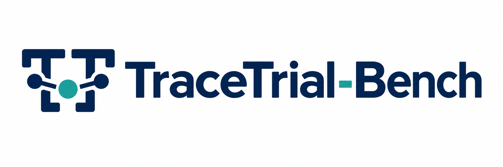
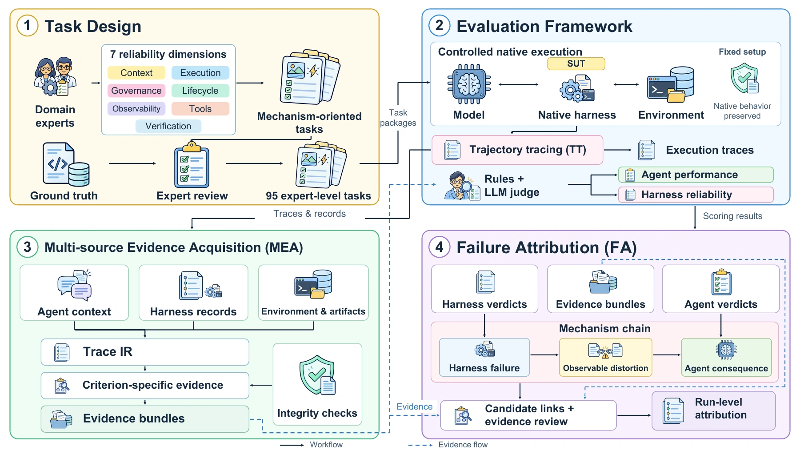
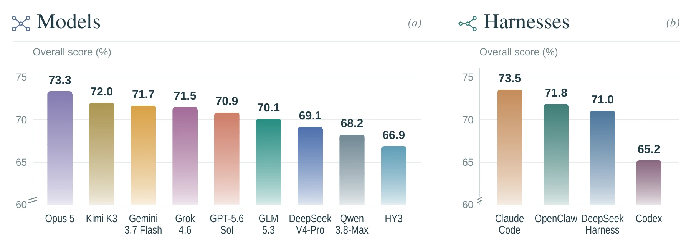

<div align="center">



**AI Agent 出错时，是模型的问题，还是 harness 的问题？**

论文代码与题集 · *Trial by Trace: Benchmarking AI Agent Harnesses for Reliability and Failure Attribution*

[](https://arxiv.org/abs/2610.32285)
[](https://tracelite.ai/trial-by-trace.html)
[](https://tracelite.ai/leaderboard.html)
[](https://huggingface.co/spaces/TraceLite-AI/Trial-by-Trace)
[](LICENSE)

[English](README.md) · **简体中文**

</div>

<p align="center">
  <a href="#项目概览">项目概览</a> ·
  <a href="#主要结果">主要结果</a> ·
  <a href="#快速上手">快速上手</a> ·
  <a href="#评测题集">评测题集</a> ·
  <a href="#引用">引用</a>
</p>

<p align="center">
  
</p>

## 项目概览

一个能执行任务的 Agent = **模型 + harness**。Harness 负责调用工具、管理上下文、请求审批、委派子 Agent，以及判断何时结束任务。论文评测了 Claude Code、Codex、OpenClaw 和 DeepSeek Harness 四种 harness。

任务是否成功，无法单独解释失败来自哪里：harness 可能吞掉了报错，但模型依然绕过障碍完成任务；harness 也可能行为正确，而模型执行失败。TraceTrial-Bench 检查**完整执行轨迹**，将这两层表现分别评分。

<p align="center">
  <a href="docs/assets/tracetrial-benchmark-main-v2.webp">
    
  </a>
</p>

<p align="center"><sub>评测框架：从机制导向题目到多源证据与运行级归因。点击图片查看原尺寸。 · <a href="https://tracelite.ai/trial-by-trace.html">官方技术报告</a></sub></p>

| 环节 | TraceTrial-Bench 做什么 |
| :--- | :--- |
| **运行** | 95 道机制导向题目 × 4 个 harness × 9 个模型，覆盖 36 种组合、3,420 次 Docker 运行。 |
| **取证** | 统一轨迹格式，提取工具调用、上下文、执行过程与任务结果中的证据。 |
| **评分** | 分别评估 **Harness 层**的框架行为与 **Agent 层**的任务表现。 |
| **归因** | 区分 harness 导致的失败、模型导致的失败，以及模型成功绕过的 harness 缺陷。 |

## 主要结果

> **31.1%** 的运行完成了任务，但至少有一条 harness 判据未通过；两层全部判据都通过的运行仅占 **8.4%**。

Claude Code 的 Agent Pass 最高，OpenClaw 的 Harness Macro 最高。四种 harness 的 Harness Macro 相差 **12.2 个百分点**，从 59.8% 到 72.0%。

<p align="center">
  <a href="docs/assets/overall-score-model-harness.webp">
    
  </a>
</p>

<p align="center"><sub>总体成绩：模型结果跨四个 harness 平均，harness 结果跨九个模型平均。 · <a href="https://tracelite.ai/trial-by-trace.html">官方技术报告</a></sub></p>

| Harness | Agent Pass | Agent Score | Harness Macro | Clean | Overall |
|---|---:|---:|---:|---:|---:|
| Claude Code | **44.0** | **75.9** | 71.2 | 9.1 | **73.5** |
| Codex | 35.8 | 70.7 | 59.8 | 2.8 | 65.2 |
| DeepSeek Harness | 40.0 | 73.3 | 68.8 | 9.8 | 71.0 |
| OpenClaw | 38.2 | 71.7 | **72.0** | **11.7** | 71.8 |

<sub>单位均为百分比，每个 harness 平均 9 个模型 × 95 道题（855 格）。加粗表示该列最优值。</sub>

<details>
<summary><strong>如何理解这些指标</strong></summary>

- **Agent Pass：**Agent 层全部判据通过。
- **Clean：**两层全部判据通过。
- **Overall：**Agent Score 与 Harness Macro 的平均。

分模型结果和案例分析见[技术报告](https://tracelite.ai/trial-by-trace.html)与[排行榜](https://tracelite.ai/leaderboard.html)。

</details>

## 快速上手

**环境要求**：Python ≥ 3.11 和 Docker。以下命令使用 Linux shell；Windows 用户请在 WSL 中运行。

### 1. 安装与配置

```bash
git clone https://github.com/TraceLite-AI/TraceTrial-Bench.git
cd TraceTrial-Bench
python3 -m venv .venv
.venv/bin/pip install -e .
cp configs/models.example.toml model.toml
chmod 600 model.toml
```

编辑 `model.toml`，填写服务地址、模型标识和 API key。下方命令使用其中的 `deepseek` 别名。该文件含凭据，请勿提交。

### 2. 构建镜像并运行一道题

```bash
.venv/bin/tracetrial_bench image build --harness openclaw \
  --model-registry ./model.toml --output-dir outputs/image-builds

.venv/bin/tracetrial_bench run --smoke --harness openclaw --model deepseek \
  --mode docker --model-registry ./model.toml --output-dir outputs/runs
```

### 3. 运行论文正式题集

```bash
.venv/bin/tracetrial_bench run --task-manifest Task/final.manifest \
  --harness openclaw --model deepseek --judge-model deepseek \
  --mode docker --concurrency 4 --model-registry ./model.toml --output-dir outputs/runs
```

### 4. 查看报告

```bash
.venv/bin/tracetrial_bench report outputs/runs/<运行目录>
```

| 输出 | 内容 |
| :--- | :--- |
| `result.json` | 状态、分数、token、花费与耗时 |
| 规范化轨迹 | 模型与 harness 的执行证据 |
| `artifacts/verifier_output/score.json` | 规则判据结果 |
| `artifacts/llm_judge/combined_score.json` | Harness 与 Agent 两层评分 |

## 评测题集

每道题对应 **7 个可靠性维度**之一。题面只提供目标、材料与交付物，不透露被测机制。

| 编码 | 维度 | 关注点 | 题数 | 节点数 |
| :---: | :--- | :--- | ---: | ---: |
| **C** | Context 上下文 | 信息保留、隔离与恢复 | 15 | 6 |
| **E** | Execution 执行 | 进程语义与结果如实送达 | 27 | 9 |
| **G** | Governance 治理 | 权限、策略与安全边界 | 9 | 4 |
| **L** | Lifecycle 生命周期 | 会话切换、任务委派与状态恢复 | 19 | 8 |
| **O** | Observability 可观测 | 诊断与失败信息的如实传递 | 7 | 2 |
| **T** | Tools 工具 | 工具接口、发现与传输保真 | 17 | 10 |
| **V** | Verification 核验 | 完成声明与权威结果是否一致 | 1 | 1 |
| | **合计** | | **95** | **40** |

**正式评测使用 [95 题清单](Task/final.manifest)。** 清单按论文第 45 页热力图从上到下排序，[命名对照](docs/task-naming.md)列出全部新旧题名和节点映射。

题名格式为 `<节点>-<描述>-<三位序号>`，例如 `C1-escalation-export-001`。开头的 `L3-` 表示 Lifecycle 第 3 个节点，难度元数据保持原值。历史 `lean96.manifest` 额外保留了未计入论文结果的 hostrecord 题。

## 仓库导航

| 路径 | 用途 |
| :--- | :--- |
| [`Task/`](Task/) | 评测题目与发布清单 |
| [`tracetrial_bench/`](tracetrial_bench/) | CLI、Docker 运行器、评分、归因与报告 |
| [`harness_tracer/`](harness_tracer/) | Harness 适配器与规范化轨迹 |
| [`verifier/`](verifier/) | 取证层（`trace_ir`）与 API 流量捕获 |
| [`docker/`](docker/) | 锁定版本的 harness 镜像 |
| [`configs/`](configs/) | 模型注册表示例 |
| [`docs/`](docs/) | 判据、归因与命名说明 |

## 引用

请引用我们发布在 [arXiv](https://arxiv.org/abs/2610.32285) 上的论文：

```bibtex
@misc{tracelite2026trialbytrace,
  title  = {Trial by Trace: Benchmarking AI Agent Harnesses
            for Reliability and Failure Attribution},
  author = {Cao, Zhiyong and Zhu, Hengjie and Wang, Yongxin and Li, Xuchen and
            Li, Jintao and Liu, Shuxia and Liu, Dunqiang and Wang, Bo and
            Zhang, Kairan and Lin, Cong and Yu, JiangDi and Liu, Siyuan and
            Yao, Sijia and Wei, Yi-Liang and Ma, Lingxu and Wang, Aijia and
            Chen, Anxin and Wei, Zixian and Ruan, Xiang and Xu, Ruizhi and
            Shi, Ruqian and Xiao, Baihua and Zhou, Sicheng},
  year   = {2026},
  eprint = {2610.32285},
  archivePrefix = {arXiv},
  primaryClass = {cs.AI},
  url    = {https://arxiv.org/abs/2610.32285}
}
```

## Star 数量趋势

<p align="center">
  <a href="https://www.star-history.com/?repos=TraceLite-AI%2FTraceTrial-Bench&amp;type=date">
    <picture>
      <source media="(prefers-color-scheme: dark)" srcset="https://api.star-history.com/svg?repos=TraceLite-AI/TraceTrial-Bench&amp;type=Date&amp;theme=dark" />
      <source media="(prefers-color-scheme: light)" srcset="https://api.star-history.com/svg?repos=TraceLite-AI/TraceTrial-Bench&amp;type=Date" />
      
    </picture>
  </a>
</p>

---

<div align="center">

由 **[TraceLite AI](https://tracelite.ai)** 开发 · [联系我们](mailto:contact@tracelite.ai) · [MIT 许可证](LICENSE)

<sub>面向 Agent 评测与后训练的开放研究：取证、归因、环境、奖励与数据生成。</sub>

</div>
