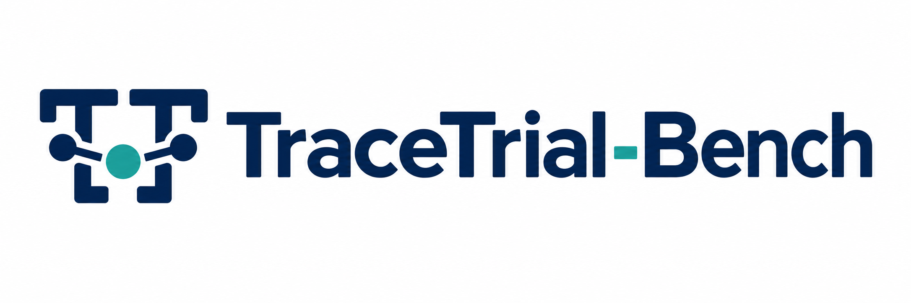
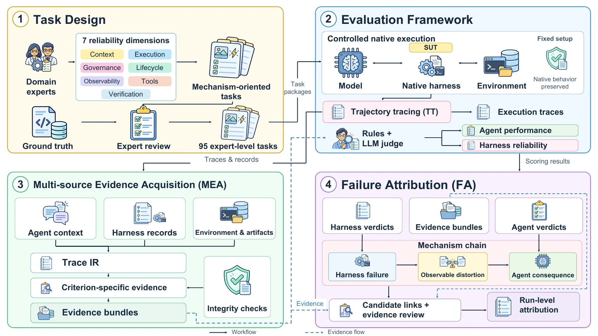
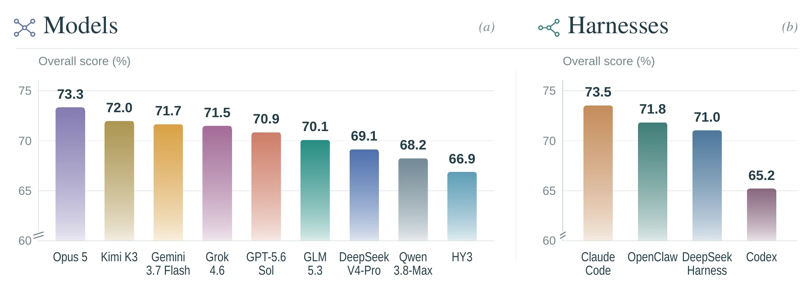

<div align="center">



**AI Agent 出错时，是模型的问题，还是 harness 的问题？**

论文代码与题集 · *Trial by Trace: Benchmarking AI Agent Harnesses for Reliability and Failure Attribution*

<p align="center">
  <a href="https://huggingface.co/papers/date/2026-10-27"></a>
</p>

[](https://arxiv.org/abs/2610.32285)
[](https://tracelite.ai/trial-by-trace.html)
[](https://tracelite.ai/leaderboard.html)
[](https://huggingface.co/spaces/TraceLite-AI/Trial-by-Trace)
[](LICENSE)

[English](README.md) · **简体中文**

</div>

<p align="center">
  <a href="#项目概览">项目概览</a> ·
  <a href="#主要结果">主要结果</a> ·
  <a href="#开源生态实证">开源生态实证</a> ·
  <a href="#快速上手">快速上手</a> ·
  <a href="#评测题集">评测题集</a> ·
  <a href="#引用">引用</a>
</p>

<p align="center">
  
</p>

## 项目概览

一个能执行任务的 Agent = **模型 + harness**。Harness 负责调用工具、管理上下文、请求审批、委派子 Agent，以及判断何时结束任务。论文评测了 Claude Code、Codex、OpenClaw 和 DeepSeek Harness 四种 harness。

任务是否成功，无法单独解释失败来自哪里：harness 可能吞掉了报错，但模型依然绕过障碍完成任务；harness 也可能行为正确，而模型执行失败。TraceTrial-Bench 检查**完整执行轨迹**，将这两层表现分别评分。

<p align="center">
  <a href="assets/tracetrial-benchmark-main-v2.webp">
    
  </a>
</p>

<p align="center"><sub>评测框架：从机制导向题目到多源证据与运行级归因。点击图片查看原尺寸。 · <a href="https://tracelite.ai/trial-by-trace.html">官方技术报告</a></sub></p>

| 环节 | TraceTrial-Bench 做什么 |
| :--- | :--- |
| **运行** | 95 道机制导向题目 × 4 个 harness × 9 个模型，覆盖 36 种组合、3,420 次 Docker 运行。 |
| **取证** | 统一轨迹格式，提取工具调用、上下文、执行过程与任务结果中的证据。 |
| **评分** | 分别评估 **Harness 层**的框架行为与 **Agent 层**的任务表现。 |
| **归因** | 区分 harness 导致的失败、模型导致的失败，以及模型成功绕过的 harness 缺陷。 |

## 主要结果

> **31.1%** 的运行完成了任务，但至少有一条 harness 判据未通过；两层全部判据都通过的运行仅占 **8.4%**。

Claude Code 的 Agent Pass 最高，OpenClaw 的 Harness Macro 最高。四种 harness 的 Harness Macro 相差 **12.2 个百分点**，从 59.8% 到 72.0%。

<p align="center">
  <a href="assets/overall-score-model-harness.webp">
    
  </a>
</p>

<p align="center"><sub>总体成绩：模型结果跨四个 harness 平均，harness 结果跨九个模型平均。 · <a href="https://tracelite.ai/trial-by-trace.html">官方技术报告</a></sub></p>

| Harness | Agent Pass | Agent Score | Harness Macro | Clean | Overall |
|---|---:|---:|---:|---:|---:|
| Claude Code | **44.0** | **75.9** | 71.2 | 9.1 | **73.5** |
| Codex | 35.8 | 70.7 | 59.8 | 2.8 | 65.2 |
| DeepSeek Harness | 40.0 | 73.3 | 68.8 | 9.8 | 71.0 |
| OpenClaw | 38.2 | 71.7 | **72.0** | **11.7** | 71.8 |

<sub>单位均为百分比，每个 harness 平均 9 个模型 × 95 道题（855 格）。加粗表示该列最优值。</sub>

<details>
<summary><strong>如何理解这些指标</strong></summary>

- **Agent Pass：**Agent 层全部判据通过。
- **Clean：**两层全部判据通过。
- **Overall：**Agent Score 与 Harness Macro 的平均。

分模型结果和案例分析见[技术报告](https://tracelite.ai/trial-by-trace.html)与[排行榜](https://tracelite.ai/leaderboard.html)。

</details>

## 开源生态实证

除评测已有发行版外，TraceTrial-Bench 的机制节点（`C`、`E`、`G`、`L`、`O`、`T`）还被用于对主流开源 Agent 框架开展系统性缺陷审计。截至目前，基于评测机制挖掘已在 **[OpenHands SDK](https://github.com/OpenHands/software-agent-sdk)**、**[OpenCode](https://github.com/anomalyco/opencode)** 与 **[Aider](https://github.com/Aider-AI/aider)** 中定位 **17 处真实可靠性缺陷与运行时短板**，提交 **14 个上游修复与特性 PR** 并获上游维护者独立复现确认——其中 5 项缺陷已被 OpenHands 核心维护者正式编入官方 `verify-sdk` 与 `verify-agent-server` 回归验收套件（[`095af36`](https://github.com/OpenHands/software-agent-sdk/commit/095af36ad87aee6b375cc5e87ac18d57787fec62)）。

### 控制变量因果验证（同一模型，仅修补 Harness）

保持底层模型、评测容器与评分判据不变，仅对定位到的 Harness 机制缺陷打上最小修复补丁，可直接分离出 Harness 可靠性对端到端任务表现的因果增益：

| 目标框架 | 机制节点 / 题目 | 修复的 Harness 缺陷或能力缺口 | 上游链接 | 实测得分变化（修复前 → 修复后） |
| :--- | :--- | :--- | :--- | :--- |
| **OpenCode** | `E9` (`E9-ptyrepl-002`) | 原生交互式 `pty` 会话工具（支持 `EOF` / `Ctrl+D` 与输出模式等待） | [#65017](https://github.com/anomalyco/opencode/issues/65017) · [`interactive-pty-tool`](https://github.com/TraceLite-AI/opencode/tree/interactive-pty-tool) | Overall **37.5 → 62.5**（`+25.0`；6/6 项 PTY 判据由 `0 → 1`） |
| **OpenCode** | `L4` / `O` / `C2` | `run --format json` 漏打后台 `<subagent>` / `<shell>` 完成通知与压缩事件 | [#64851](https://github.com/anomalyco/opencode/issues/64851) · [PR #64852](https://github.com/anomalyco/opencode/pull/64852) | Overall **45.0 → 60.0**（`+15.0`；Harness **20.0 → 35.0**） |
| **OpenHands SDK** | `T3` (`T3-reserved-tool-name-001`) | 单 MCP Server 工具与内置 `terminal` 重名时直接抛异常中断会话初始化 | [#6992](https://github.com/OpenHands/software-agent-sdk/issues/6992) · [PR #6988](https://github.com/OpenHands/software-agent-sdk/pull/6988) | Overall **0.0 → 33.3**（Harness **0.0 → 42.9**） |
| **Aider** | `G` / `E1` (`E1-drainexit-001`) | `--message` 非交互模式下支持 `--yes-shell-commands` 并向模型回传命令输出 | [PR #6002](https://github.com/Aider-AI/aider/pull/6002) | Overall **25.0 → 37.5**（Harness **14.3 → 28.6**） |

<details>
<summary><strong>展开查看全部 14 个上游修复与特性 PR 清单（OpenHands / OpenCode / Aider）</strong></summary>

<br>

| 目标框架 | 节点 | 关联议题与官方定级 | Pull Request | 缺陷与修复摘要 |
| :--- | :--- | :--- | :--- | :--- |
| **OpenHands SDK** | `G2` × `L` | [#6999](https://github.com/OpenHands/software-agent-sdk/issues/6999)（`priority:high`、`ready-for-dev`，已纳入官方 [`S11/task_fail_closed`](https://github.com/OpenHands/software-agent-sdk/commit/095af36ad87aee6b375cc5e87ac18d57787fec62)） | [PR #7001](https://github.com/OpenHands/software-agent-sdk/pull/7001) | 修复子智能体在无 `confirmation_handler` 时对 `WAITING_FOR_CONFIRMATION` 动作静默放行（fail-open）及漏传 `security_analyzer` 的安全漏洞 |
| **OpenHands SDK** | `G4` × `C2` × `L` | [#7002](https://github.com/OpenHands/software-agent-sdk/issues/7002)（`priority:medium`、`ready-for-dev`） | [PR #7003](https://github.com/OpenHands/software-agent-sdk/pull/7003) | 修复 `SecretRegistry.update_secrets()` 新密钥及轮换后旧密钥脱敏失效与父子智能体脱敏同步问题 |
| **OpenHands SDK** | `L` | [#6990](https://github.com/OpenHands/software-agent-sdk/issues/6990)（`priority:medium`、`ready-for-dev`，已纳入官方 [`S11/task_resume_session`](https://github.com/OpenHands/software-agent-sdk/commit/095af36ad87aee6b375cc5e87ac18d57787fec62)） | [PR #6986](https://github.com/OpenHands/software-agent-sdk/pull/6986) | 持久化子智能体任务索引与原始 `subagent_type`，修复父会话重开后无法恢复子智能体的问题 |
| **OpenHands SDK** | `O` × `L` | [#3907](https://github.com/OpenHands/software-agent-sdk/issues/3907)（`priority:medium`、`ready-for-dev`） | [PR #6997](https://github.com/OpenHands/software-agent-sdk/pull/6997) | 支持携带 `parent_tool_use_id` 将子智能体内部事件实时转发至父级事件流 |
| **OpenHands SDK** | `C2` | [#6995](https://github.com/OpenHands/software-agent-sdk/issues/6995)（`priority:medium`、`ready-for-dev`） | [PR #6998](https://github.com/OpenHands/software-agent-sdk/pull/6998) | `<preserved_facts>` 实体锚点保留压缩提示词与多轮上下文压缩度量 |
| **OpenHands SDK** | `E2` | [#6991](https://github.com/OpenHands/software-agent-sdk/issues/6991)（`priority:low`、`ready-for-dev`，已纳入官方 [`S14/terminal_flags`](https://github.com/OpenHands/software-agent-sdk/commit/095af36ad87aee6b375cc5e87ac18d57787fec62)） | [PR #6987](https://github.com/OpenHands/software-agent-sdk/pull/6987) | 修复硬超时与无输出超时分支漏设 `TerminalObservation.timeout=True` 的问题 |
| **OpenHands SDK** | `T3` | [#6992](https://github.com/OpenHands/software-agent-sdk/issues/6992)（`priority:low`、`ready-for-dev`，已纳入官方 [`S09/conversation`](https://github.com/OpenHands/software-agent-sdk/commit/095af36ad87aee6b375cc5e87ac18d57787fec62)） | [PR #6988](https://github.com/OpenHands/software-agent-sdk/pull/6988) | 单 MCP Server 工具与内置工具重名时自动降级为 `<server>_<tool>` 前缀隔离 |
| **OpenHands SDK** | `T7` | [#6993](https://github.com/OpenHands/software-agent-sdk/issues/6993)（`priority:low`、`ready-for-dev`，已纳入官方 [`S09/conversation`](https://github.com/OpenHands/software-agent-sdk/commit/095af36ad87aee6b375cc5e87ac18d57787fec62)） | [PR #6989](https://github.com/OpenHands/software-agent-sdk/pull/6989) | 在 `MCPToolObservation` 中完整保留 `EmbeddedResource` 文本与纯 `structuredContent` 载荷 |
| **OpenHands SDK** | `E3` / `E6` | [#7017](https://github.com/OpenHands/software-agent-sdk/issues/7017)（`priority:low`、`ready-for-dev`） | [PR #7025](https://github.com/OpenHands/software-agent-sdk/pull/7025) | 为 `TerminalAction` 新增可选 `hard_timeout` 前台作业进程组阶梯收割与错误标记 |
| **OpenHands SDK** | `C1` | [#6994](https://github.com/OpenHands/software-agent-sdk/issues/6994)（`priority:low`） | [PR #7024](https://github.com/OpenHands/software-agent-sdk/pull/7024) | 结构化输出截断元数据 `TruncationMetadata`（精确字符/行号区间与持久化脱敏落盘） |
| **OpenCode** | `T7` | [#64837](https://github.com/anomalyco/opencode/issues/64837)（`type/bug`、`status/repro-simulated`） | [PR #64838](https://github.com/anomalyco/opencode/pull/64838) | 修复直连 MCP 工具丢弃 `structuredContent`、结构化错误与文本资源元数据的问题 |
| **OpenCode** | `G2` × `L` | [#64840](https://github.com/anomalyco/opencode/issues/64840)（`type/bug`、`status/repro-simulated`） | [PR #64841](https://github.com/anomalyco/opencode/pull/64841) | 修复 `SubagentTool` 忽略会话级权限及父会话权限变更未向后代会话级联同步的问题 |
| **OpenCode** | `L4` / `O` / `C2` | [#64851](https://github.com/anomalyco/opencode/issues/64851)（`type/feature`、`area/cli`） | [PR #64852](https://github.com/anomalyco/opencode/pull/64852) | 支持 `opencode run --format json` 实时流式输出与对账补齐后台通知及压缩事件 |
| **Aider** | `G` / `E1` | [#6003](https://github.com/Aider-AI/aider/issues/6003)（关联遥测提案） | [PR #6002](https://github.com/Aider-AI/aider/pull/6002) | 支持 `--yes-shell-commands` 非交互执行并在 `--message` 模式下将输出回传模型 |

</details>

## 社区运行结果

**SophiaLabs：**[Nomos × TraceTrial-Bench](https://github.com/mgantlett/nomos-tracetrial/tree/92f4958dbc3f3fff3905b0e67e427d45aafde8e6) 在 95 道题上对比了原版 Claude Code 与 Claude Code + Nomos（共 190 次选定运行，每组每题保留一次）。发布内容包括轨迹、配置与评分表。

我们核对了已发布轨迹包的校验和，并按评分表原样重新计算了主要平均分；没有重新评分，也没有重跑任务。有两组配对任务在两组之间使用了不同的时间预算；有两份评分表的 Agent 单项分记为 2 或 3，而评分规则要求为 0 或 1。这些是社区报告的结果，不是官方排行榜条目，也不是独立复现。

实验分析见 SophiaLabs 的[技术报告](https://sophialabs.ca/dispatches/tracetrial-bench-paired-harness-audit)。

### 提交社区运行结果

用自己的 harness、模型或配置跑过 TraceTrial-Bench？欢迎提交一个 [issue](https://github.com/TraceLite-AI/TraceTrial-Bench/issues/new)，标题写 `Community run: <名称>`，并附上：

- 固定到某个 commit 或 release 的公开链接，内含轨迹、解析后的运行配置和 `combined_score.json` 评分表；
- 轨迹包的校验和；
- 所用题集清单（manifest），以及每道题保留了几次运行；
- 如果是配对对比，请说明两组使用了相同的题目、时间预算和评审模型；
- 如有文字报告，请附链接。

我们会根据已发布文件做力所能及的核对（例如校验和、根据评分表重算主要平均分），并在此列为社区报告结果。社区结果不是官方排行榜条目，列出也不代表我们已复现。

## 快速上手

**环境要求**：Python ≥ 3.11 和 Docker。以下命令使用 Linux shell；Windows 用户请在 WSL 中运行。

### 1. 安装与配置

```bash
git clone https://github.com/TraceLite-AI/TraceTrial-Bench.git
cd TraceTrial-Bench
python3 -m venv .venv
.venv/bin/pip install -e .
cp configs/models.example.toml model.toml
chmod 600 model.toml
```

编辑 `model.toml`，填写服务地址、模型标识和 API key。下方命令使用其中的 `deepseek` 别名。该文件含凭据，请勿提交。

### 2. 构建镜像并运行一道题

```bash
.venv/bin/tracetrial_bench image build --harness openclaw \
  --model-registry ./model.toml --output-dir outputs/image-builds

.venv/bin/tracetrial_bench run --task Task/C1-escalation-export-001 --harness openclaw --model deepseek \
  --mode docker --model-registry ./model.toml --output-dir outputs/runs
```

### 3. 运行论文正式题集

```bash
.venv/bin/tracetrial_bench run --task-manifest Task/final.manifest \
  --harness openclaw --model deepseek --judge-model deepseek \
  --mode docker --concurrency 4 --model-registry ./model.toml --output-dir outputs/runs
```

DeepSeek Harness 镜像现在安装 dsh 0.2.2-rc.5，并使用其官方 `sdk` profile 运行。论文中的 DeepSeek Harness 结果基于 0.1.0-rc.6；如需复现，请切换到 [`paper-v1`](https://github.com/TraceLite-AI/TraceTrial-Bench/tree/paper-v1) 分支。dsh 0.2 通过 Anthropic Messages API 调用模型，因此需要为它单独配置一个 `base_url` 为 `https://api.deepseek.com/anthropic` 的模型别名（见 `configs/models.example.toml`）。

### 4. 查看报告

```bash
.venv/bin/tracetrial_bench report outputs/runs/<运行目录>
```

| 输出 | 内容 |
| :--- | :--- |
| `result.json` | 状态、分数、token、花费与耗时 |
| 规范化轨迹 | 模型与 harness 的执行证据 |
| `artifacts/verifier_output/score.json` | 规则判据结果 |
| `artifacts/llm_judge/combined_score.json` | Harness 与 Agent 两层评分 |

## 评测题集

每道题对应 **7 个可靠性维度**之一。题面只提供目标、材料与交付物，不透露被测机制。

| 编码 | 维度 | 关注点 | 题数 | 节点数 |
| :---: | :--- | :--- | ---: | ---: |
| **C** | Context 上下文 | 信息保留、隔离与恢复 | 15 | 6 |
| **E** | Execution 执行 | 进程语义与结果如实送达 | 27 | 9 |
| **G** | Governance 治理 | 权限、策略与安全边界 | 9 | 4 |
| **L** | Lifecycle 生命周期 | 会话切换、任务委派与状态恢复 | 19 | 8 |
| **O** | Observability 可观测 | 诊断与失败信息的如实传递 | 7 | 2 |
| **T** | Tools 工具 | 工具接口、发现与传输保真 | 17 | 10 |
| **V** | Verification 核验 | 完成声明与权威结果是否一致 | 1 | 1 |
| | **合计** | | **95** | **40** |

**正式评测使用 [95 题清单](Task/final.manifest)。** 清单按论文第 45 页热力图从上到下排序。

题名格式为 `<节点>-<描述>-<三位序号>`，例如 `C1-escalation-export-001`。开头的 `L3-` 表示 Lifecycle 第 3 个节点，难度元数据保持原值。历史 `lean96.manifest` 额外保留了未计入论文结果的 hostrecord 题。

## 仓库导航

| 路径 | 用途 |
| :--- | :--- |
| [`Task/`](Task/) | 评测题目与发布清单 |
| [`tracetrial_bench/`](tracetrial_bench/) | CLI、Docker 运行器、评分、归因与报告 |
| [`harness_tracer/`](harness_tracer/) | Harness 适配器与规范化轨迹 |
| [`verifier/`](verifier/) | 取证层（`trace_ir`）与 API 流量捕获 |
| [`docker/`](docker/) | 锁定版本的 harness 镜像 |
| [`configs/`](configs/) | 模型注册表示例 |

## 引用

请引用我们发布在 [arXiv](https://arxiv.org/abs/2610.32285) 上的论文：

```bibtex
@misc{tracelite2026trialbytrace,
  title  = {Trial by Trace: Benchmarking AI Agent Harnesses
            for Reliability and Failure Attribution},
  author = {Cao, Zhiyong and Zhu, Hengjie and Wang, Yongxin and Li, Xuchen and
            Li, Jintao and Liu, Shuxia and Liu, Dunqiang and Wang, Bo and
            Zhang, Kairan and Lin, Cong and Yu, JiangDi and Liu, Siyuan and
            Yao, Sijia and Wei, Yi-Liang and Ma, Lingxu and Wang, Aijia and
            Chen, Anxin and Wei, Zixian and Ruan, Xiang and Xu, Ruizhi and
            Shi, Ruqian and Xiao, Baihua and Zhou, Sicheng},
  year   = {2026},
  eprint = {2610.32285},
  archivePrefix = {arXiv},
  primaryClass = {cs.AI},
  url    = {https://arxiv.org/abs/2610.32285}
}
```

## Star 数量趋势

<p align="center">
  <a href="https://www.star-history.com/?repos=TraceLite-AI%2FTraceTrial-Bench&amp;type=date">
    <picture>
      <source media="(prefers-color-scheme: dark)" srcset="https://api.star-history.com/svg?repos=TraceLite-AI/TraceTrial-Bench&amp;type=Date&amp;theme=dark" />
      <source media="(prefers-color-scheme: light)" srcset="https://api.star-history.com/svg?repos=TraceLite-AI/TraceTrial-Bench&amp;type=Date" />
      
    </picture>
  </a>
</p>

---

<div align="center">

由 **[TraceLite AI](https://tracelite.ai)** 开发 · [联系我们](mailto:contact@tracelite.ai) · [MIT 许可证](LICENSE)

<sub>面向 Agent 评测与后训练的开放研究：取证、归因、环境、奖励与数据生成。</sub>

</div>
